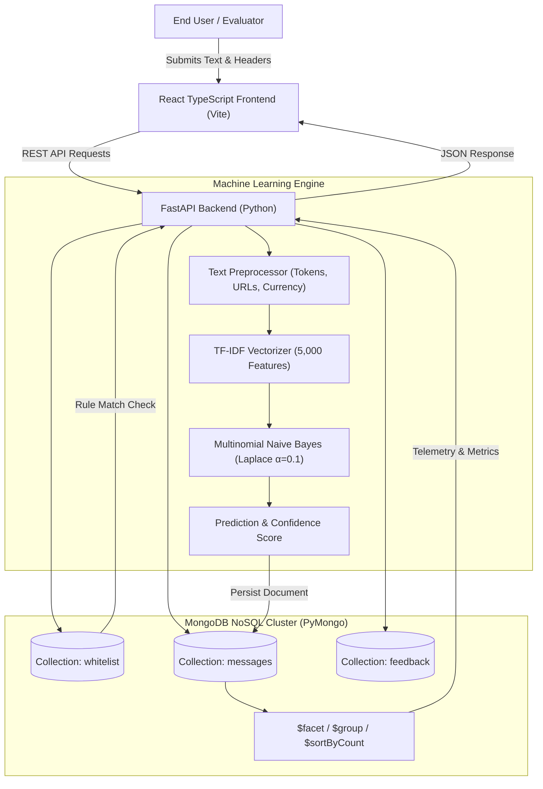

# SpamSentinel AI: Intelligent SMS & Email Spam Detection and Archival System using MongoDB

> **Project:** Intelligent Spam Detection & Archival System  
> **Persistence Engine:** MongoDB 8.x + Native PyMongo Driver  
> **Machine Learning:** Scikit-Learn TF-IDF + Multinomial Naive Bayes  
> **Architecture:** React 19 + TypeScript + Vite + Tailwind CSS + Python FastAPI + PyMongo 4.x  

---

## 1. Project Introduction

**SpamSentinel AI** is an intelligent cybersecurity and database application engineered to classify incoming text communications (SMS, notifications, emails) as either **Spam** (unsolicited/malicious) or **Ham** (legitimate/safe). 

All predictions, probability confidence distributions, and human audits are persistently recorded into **MongoDB** using the official **PyMongo** driver. The system provides real-time ML inference, granular message querying, quarantine archiving, administrative whitelisting, and deep analytical aggregation pipelines.

---

## 2. Problem Statement

Modern communication channels are saturated with unsolicited promotional messages, financial prize phishing scams, and fraudulent impersonations. Conventional rule-based filters struggle with adaptive vocabulary, while traditional relational databases (RDBMS) suffer from rigid schemas when handling evolving message metadata, dynamic tokens, and rapid audit logs.

**SpamSentinel AI** resolves this by fusing:
1. **Sub-millisecond Machine Learning Inference:** TF-IDF feature extraction with Multinomial Naive Bayes classification.
2. **Flexible Document Persistence:** Document-oriented MongoDB collections (`messages`, `whitelist`, `feedback`) managed strictly via PyMongo.
3. **Quarantine & Whitelist Lifecycle Management:** Complete CRUD workflows allowing users to quarantine spam, purge bulk junk, and whitelist false-positive communications.

---

## 3. Core Objectives

- **Automated Text Classification:** Ingest raw text snippets and evaluate class probabilities with $>98\%$ test accuracy.
- **Pure PyMongo Integration:** Demonstrate end-to-end NoSQL database operations (Insert, Find, Update, Delete, Compound Indexing, and Aggregations).
- **Academic Assessment Standard:** Provide transparent evaluation metrics (Confusion Matrix, Precision, Recall, F1-Score) based on the official UCI SMS Spam Collection dataset.
- **Enterprise-Grade UI/UX:** Deliver a modern dashboard with real-time statistics, activity histograms, keyword triggers, and an interactive NoSQL query explorer for viva presentations.

---

## 4. Key Features

- **Real-Time Spam Classifier:** Instant analysis with confidence gauge, keyword breakdown, and probability distribution.
- **Sample Seed Generator:** One-click pre-loading of realistic demonstration messages for academic evaluation.
- **Comprehensive Message History:** Filterable table supporting regex text search, prediction filters, status filters, sorting, and pagination.
- **Spam Quarantine Archive:** Isolated vault for malicious messages with a one-click **"Empty Spam Folder"** bulk purge (`delete_many()`).
- **Administrative Whitelist Manager:** Custom rules (by sender, keyword, domain, or phrase) that take precedence over the ML model.
- **Human-in-the-Loop Feedback:** False-positive reporting mechanism logging audit documents into MongoDB.
- **Live Aggregation Dashboards:** Real-time metrics powered by MongoDB `$facet`, `$group`, `$unwind`, and `$sortByCount` pipelines.
- **NoSQL Viva Explorer:** In-app panel displaying the exact PyMongo queries running behind each user action.

---

## 5. Technology Stack

| Layer | Technologies |
|---|---|
| **Frontend** | React 19, TypeScript, Vite, Tailwind CSS v4, Lucide React, Recharts, Axios, React Router |
| **Backend API** | Python 3.10+, FastAPI, Pydantic v2, Uvicorn, Python-Dotenv |
| **Database & Driver** | MongoDB Community Server / MongoDB Atlas, PyMongo 4.x (No ODM / No Prisma) |
| **Machine Learning** | Scikit-learn (TfidfVectorizer, MultinomialNB), Pandas, NumPy, Joblib |
| **Testing** | Pytest, FastAPI TestClient, Starlette |

---

## 6. System Architecture



---

## 7. Dataset Source & Attribution

The model is trained on the official **UCI Machine Learning Repository: SMS Spam Collection Dataset**.
- **Dataset Link:** [https://archive.ics.uci.edu/dataset/228/sms+spam+collection](https://archive.ics.uci.edu/dataset/228/sms+spam+collection)
- **Local Dataset Path:** `DataSets/SMSSpamCollection`
- **SHA-256 Checksum:** `7d039a24a6083ed9ef0f806ebad56bbb976e3aeb8de05669173bfdc4996c239d` (Size: 477,907 bytes)
- **Dataset Size:** 5,574 labeled communications (4,827 Ham [86.60%], 747 Spam [13.40%]).
- **Training Strategy:** 80% Training (4,459 samples), 20% Testing (1,115 samples) with stratified splitting to prevent data leakage.
- **Dataset Scope & Evaluation Boundary:** The training dataset consists strictly of mobile SMS communications. While the web interface accepts arbitrary text pasted from SMS or emails, the model vocabulary is optimized for SMS communication patterns. Email-specific spam patterns (e.g., HTML structure, MIME headers) have not been independently evaluated.

---

## 8. Machine Learning Pipeline & Benchmark Metrics

The classifier was trained using a sublinear TF-IDF vectorizer ($n$-gram range $1$–$2$, stop words removed) paired with a Multinomial Naive Bayes classifier.

### Real Calculated Benchmark Metrics (Test Set $N = 1,115$):

- **Accuracy:** **98.74%**
- **Precision (Spam):** **97.20%**
- **Recall (Spam):** **93.29%**
- **F1-Score:** **95.21%**
- **Vocabulary Features:** **5,000**
- **Inference Latency:** **$< 15$ ms**

### Confusion Matrix Breakdown:
- **True Negatives (TN):** 962 legitimate messages correctly identified as Ham.
- **False Positives (FP):** 4 legitimate messages flagged as Spam.
- **False Negatives (FN):** 10 spam messages classified as Ham.
- **True Positives (TP):** 139 spam messages correctly intercepted.

---

## 9. MongoDB Database Design & Collections

Database Name: `spamguard_db` (or configurable via `.env`).

### Collection 1: `messages`
Stores each evaluated communication along with ML predictions, whitelist override metadata, and audit status:
```json
{
  "_id": { "$oid": "6640c72e9d2a4f0012ab34cd" },
  "text": "Congratulations! You have won £1,000 cash prize! Call 0906121 to claim your reward!",
  "sender": "+447911123456",
  "prediction": "spam",
  "model_prediction": "spam",
  "classification_source": "ml_model",
  "whitelist_reason": null,
  "confidence": 0.9872,
  "spam_probability": 0.9872,
  "ham_probability": 0.0128,
  "highlighted_keywords": ["claim", "cash", "prize", "currency_symbol", "num_code"],
  "status": "unreviewed",
  "source": "manual",
  "created_at": { "$date": "2025-03-16T10:15:30.000Z" },
  "updated_at": { "$date": "2025-03-16T10:15:30.000Z" }
}
```

### Collection 2: `whitelist`
Stores trusted senders, domains, and keywords:
```json
{
  "_id": { "$oid": "6640c72e9d2a4f0012ab34ce" },
  "value": "alerts@university.edu",
  "type": "sender",
  "note": "Verified campus alert dispatch",
  "created_at": { "$date": "2025-03-16T10:00:00.000Z" }
}
```

### Collection 3: `feedback`
Stores human-in-the-loop corrections:
```json
{
  "_id": { "$oid": "6640c72e9d2a4f0012ab34cf" },
  "message_id": "6640c72e9d2a4f0012ab34cd",
  "actual_label": "ham",
  "predicted_label": "spam",
  "feedback": "Legitimate coupon alert from opted-in store",
  "created_at": { "$date": "2025-03-16T10:20:00.000Z" }
}
```

---

## 10. PyMongo Operations Catalog for Viva

| Operation | PyMongo Implementation | Description |
|---|---|---|
| **Create (Insert)** | `col.insert_one(doc)` | Stores new classification document |
| **Read (Find & Paginate)** | `col.find(query).sort("created_at", -1).skip(skip).limit(limit)` | Search with sorting & pagination |
| **Update (Status)** | `col.find_one_and_update({"_id": ObjectId(id)}, {"$set": {"status": "whitelisted"}})` | Updates status to whitelisted or archived |
| **Delete (Single)** | `col.delete_one({"_id": ObjectId(id)})` | Deletes single record |
| **Delete (Bulk Purge)** | `col.delete_many({"status": "archived"})` | Empties spam quarantine folder |
| **Indexing** | `col.create_index([("created_at", -1)])` | Builds compound & single indexes |
| **Multi-Facet Aggregation** | `col.aggregate([{"$facet": {"total": [...], "by_prediction": [...]}}])` | Calculates dashboard KPIs in 1 network call |
| **Keyword Aggregation** | `col.aggregate([{"$unwind": "$highlighted_keywords"}, {"$sortByCount": "..."}])` | Aggregates most frequent spam tokens |

---

## 11. Backend API Endpoints

- `POST /api/detect` — Real-time text spam detection & MongoDB insertion.
- `POST /api/detect/seed-samples` — Seed 8 demonstration records into MongoDB.
- `GET /api/messages` — Paginated message list with regex search, prediction, and status filters.
- `GET /api/messages/{id}` — Retrieve single message details.
- `PATCH /api/messages/{id}/status` — Update message status (`unreviewed`, `archived`, `whitelisted`).
- `DELETE /api/messages/{id}` — Delete message document.
- `GET /api/archive` — View quarantined spam messages.
- `POST /api/archive/{id}` — Move message to quarantine.
- `POST /api/archive/restore/{id}` — Restore quarantined message to inbox.
- `DELETE /api/archive/purge/all` — Bulk purge spam messages (`delete_many`).
- `GET /api/whitelist` — List whitelist entries.
- `POST /api/whitelist` — Add whitelist entry.
- `DELETE /api/whitelist/{id}` — Delete whitelist entry.
- `GET /api/analytics` — MongoDB aggregation pipeline results.
- `GET /api/analytics/model-metrics` — Real benchmark metrics & confusion matrix.
- `POST /api/feedback` — Submit false-positive / false-negative corrections.
- `GET /api/health` — Check backend and MongoDB connectivity.

---

## 12. Quick Start Guide

### Prerequisites
- **Python 3.9+** (Tested on Python 3.13)
- **Node.js v18+** (Tested on Node v24)
- **MongoDB** running locally on port 27017 or a MongoDB Atlas URI

### Option A: One-Click Startup (Windows)
Double-click `start_all.bat` or run:
```powershell
.\start_all.bat
```
This automatically launches both backend and frontend servers in separate windows.

---

### Option B: Manual Setup

#### 1. Backend Setup
```bash
cd backend

# Install dependencies
pip install -r requirements.txt

# (Optional) Retrain ML Model if needed (Pre-trained artifacts already included)
python ml/train_model.py

# Run FastAPI backend
python -m uvicorn app.main:app --host 127.0.0.1 --port 8000 --reload
```
Backend API will be accessible at: `http://localhost:8000`  
Swagger Interactive Docs: `http://localhost:8000/docs`

#### 2. Frontend Setup
```bash
cd frontend

# Install npm dependencies
npm install

# Start development server
npm run dev
```
Frontend Web Application will be accessible at: `http://localhost:5173`

---

## 13. Running Automated Tests

Run backend tests using PyTest to verify all endpoints, validation rules, and PyMongo CRUD operations:
```bash
cd backend
python -m pytest test_backend.py -v
```

All 8 test suites will execute and pass:
- `test_root_and_health`
- `test_empty_or_whitespace_message_validation` (rejection with HTTP 422, 0 DB inserts)
- `test_spam_detection_endpoint`
- `test_messages_crud`
- `test_archive_flow`
- `test_whitelist_flow` (verifies `classification_source`, `model_prediction`, and override)
- `test_analytics_and_metrics`
- `test_feedback_flow`

You can also run the full pipeline integrity verification:
```bash
python verify_pipeline.py
```

---

## 14. 20-Second Viva Pitch for Evaluators

> *"Sir, whenever an SMS or email text arrives, our system sanitizes the text, extracts unigram and bigram features using TF-IDF, and evaluates class posterior probabilities using Multinomial Naive Bayes trained on the official UCI SMS Spam Collection (achieving 98.74% accuracy). The prediction label, confidence score, and token highlights are persistently stored in MongoDB using PyMongo. The user can perform full CRUD operations—searching records, restoring false positives, isolating spam in a quarantine archive, whitelisting trusted senders, or executing a bulk purge via `delete_many()`."*

