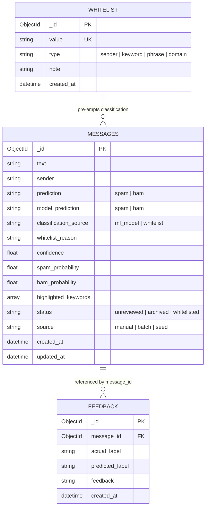
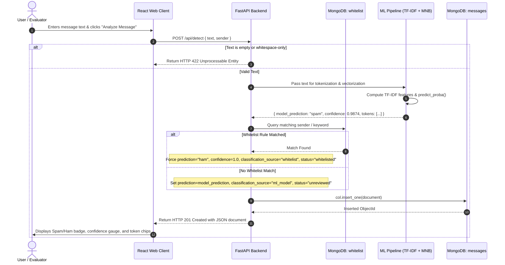

# System Design and Architecture Specification

## SpamSentinel AI: Intelligent SMS & Email Spam Detection and Archival System using MongoDB

```text
Course Code:        CSE-494 (Intelligent NoSQL Databases)
Student Name:       Nilanshu Kumar Singh
Repository:         https://github.com/nilanshukumarsingh/SpamSentinel
Academic Session:   2024-2025 (Spring Semester)
```

---

## 1. High-Level Architecture

The system is constructed as a decoupled, multi-tiered architecture comprising a client presentation tier, an asynchronous API middleware tier, a machine learning inference engine, and a document-oriented persistence cluster.

```mermaid
graph TD
    subgraph Client_Presentation_Tier["Presentation Tier (Frontend)"]
        UI_Dash["Dashboard (Recharts)"]
        UI_Detect["Spam & Phishing Studio"]
        UI_Hist["Log History & Search"]
        UI_Arch["Quarantine Vault"]
        UI_White["Whitelist Policies"]
        UI_NoSQL["NoSQL Query Explorer"]
    end

    subgraph API_Middleware_Tier["API Middleware Tier (FastAPI)"]
        Router_Detect["/api/detect"]
        Router_Msg["/api/messages"]
        Router_Arch["/api/archive"]
        Router_White["/api/whitelist"]
        Router_Analytics["/api/analytics"]
        Router_Feedback["/api/feedback"]
    end

    subgraph Machine_Learning_Core["Machine Learning Engine"]
        Tokenizer["Preprocessing & Tokenizer"]
        TFIDF["TF-IDF Vectorizer (5,000 Features)"]
        NaiveBayes["Multinomial Naive Bayes (α=0.1)"]
    end

    subgraph Database_Tier["NoSQL Persistence Tier (MongoDB 8.x)"]
        Col_Messages[("Collection: messages")]
        Col_Whitelist[("Collection: whitelist")]
        Col_Feedback[("Collection: feedback")]
    end

    Client_Presentation_Tier -->|HTTP REST / JSON| API_Middleware_Tier
    Router_Detect --> Tokenizer --> TFIDF --> NaiveBayes
    Router_Detect -->|Check Policy| Col_Whitelist
    Router_Detect -->|Persist Result| Col_Messages
    Router_Msg -->|find / updateOne / deleteOne| Col_Messages
    Router_Arch -->|deleteMany (Empty Spam)| Col_Messages
    Router_White -->|CRUD Rules| Col_Whitelist
    Router_Analytics -->|Aggregate Pipelines| Col_Messages
    Router_Feedback -->|Audit Logs| Col_Feedback
```

---

## 2. Component Design

### 2.1 Presentation Tier
- **Framework:** React 19 + TypeScript + Vite.
- **Styling:** Tailwind CSS v4 with custom responsive flex-grid layouts and dark navy cyber accents.
- **Data Visualizations:** Recharts (`PieChart`, `BarChart`, `ResponsiveContainer`).
- **Icons:** Lucide React icons.
- **Proxy Configuration:** Vite reverse proxies `/api/*` requests to the local ASGI server at `http://127.0.0.1:8000`.

### 2.2 Middleware Tier (FastAPI)
- **ASGI Server:** Uvicorn running on asynchronous event loops.
- **Validation Engine:** Pydantic models ensuring strict schema enforcement and type safety.
- **CORS Policies:** Configured for cross-origin access across ports 5173, 3000, and production web addresses.
- **Lifespan Manager:** Connects PyMongo client, verifies index structures, and pre-loads model artifacts into memory on server boot.

### 2.3 Machine Learning Pipeline
1. **Cleaning:** Lowercase, regex replacement of URLs (`http_url`), monetary values (`currency_symbol`), and numeric codes (`num_code`).
2. **Feature Extraction:** Sublinear TF-IDF scaling over 5,000 vocabulary unigrams and bigrams fitted strictly on training data.
3. **Inference:** Multinomial Naive Bayes posterior probability evaluation yielding class prediction and exact confidence percentage.
4. **Explainability & Token Impact:** Salient tokens are extracted and ranked based on MultinomialNB log-odds difference: $\log P(w|\text{spam}) - \log P(w|\text{ham})$, labeled as "Recognized Vocabulary Tokens".
5. **Dataset Scope & Evaluation:** Trained on the official UCI SMS Spam Collection (SHA-256: `7d039a24a6083ed9ef0f806ebad56bbb976e3aeb8de05669173bfdc4996c239d`). The system accepts pasted email bodies via the web UI, but accuracy metrics are benchmarked on the SMS corpus; email-specific accuracy has not been independently evaluated.

### 2.4 Database Tier (PyMongo)
- **Database:** `spamguard_db`
- **Collections:**
  - `messages`: Stores processed text, predictions, confidence scores, keyword triggers, and timestamps.
  - `whitelist`: Stores administrator-approved senders, keywords, domains, and phrases.
  - `feedback`: Stores false-positive and false-negative audit logs.

---

## 3. Entity-Relationship & Document Association



---

## 4. Sequence Diagram: Real-Time Detection Workflow



---

## 5. MongoDB Aggregation Pipeline Specifications

### 5.1 Multi-Faceted System Telemetry Pipeline (`$facet`)
Executes total counts, prediction distributions, and review status breakdowns in a single database round-trip:

```javascript
db.messages.aggregate([
  {
    $facet: {
      "total": [{ $count: "count" }],
      "by_prediction": [
        { $group: { _id: "$prediction", count: { $sum: 1 } } }
      ],
      "by_status": [
        { $group: { _id: "$status", count: { $sum: 1 } } }
      ]
    }
  }
])
```

### 5.2 Chronological Daily Activity Pipeline (`$group`)
Groups incoming volume by date and prediction tag for time-series charts:

```javascript
db.messages.aggregate([
  {
    $group: {
      _id: {
        date: { $dateToString: { format: "%Y-%m-%d", date: "$created_at" } },
        prediction: "$prediction"
      },
      count: { $sum: 1 }
    }
  },
  { $sort: { "_id.date": 1 } }
])
```

### 5.3 Keyword Frequency Aggregation Pipeline (`$unwind` + `$sortByCount`)
Unwinds the array of extracted tokens from spam messages to identify recurring scam keywords:

```javascript
db.messages.aggregate([
  {
    $match: {
      prediction: "spam",
      highlighted_keywords: { $exists: true, $ne: [] }
    }
  },
  { $unwind: "$highlighted_keywords" },
  {
    $match: {
      highlighted_keywords: { $nin: ["num_code", "currency_symbol", "http_url"] }
    }
  },
  { $sortByCount: "$highlighted_keywords" },
  { $limit: 8 }
])
```

---

## 6. REST API Endpoint Specifications

| Method | Endpoint | Description | Request Body | Response Code |
|---|---|---|---|---|
| `POST` | `/api/detect` | Runs ML inference & saves to MongoDB (rejects empty/whitespace with 422) | `{ text, sender, source }` | `201 Created` / `422` |
| `POST` | `/api/detect/batch` | Classifies multiple messages | `{ messages: [string] }` | `200 OK` |
| `POST` | `/api/detect/seed-samples` | Seeds 8 realistic demo messages | None | `200 OK` |
| `GET` | `/api/messages` | Searchable & paginated message query | Query parameters | `200 OK` |
| `GET` | `/api/messages/{id}` | Retrieve single message by ObjectId | None | `200 OK` / `404` |
| `PATCH`| `/api/messages/{id}/status` | Updates status (`whitelisted`, `archived`) | `{ status: string }` | `200 OK` |
| `DELETE`| `/api/messages/{id}` | Deletes a single document | None | `200 OK` |
| `GET` | `/api/archive` | Lists quarantined spam messages | Query parameters | `200 OK` |
| `POST` | `/api/archive/{id}` | Quarantines a message | None | `200 OK` |
| `POST` | `/api/archive/restore/{id}`| Restores message from archive | None | `200 OK` |
| `DELETE`| `/api/archive/purge/all` | Bulk purge spam records (`deleteMany`) | `?target=archived` | `200 OK` |
| `GET` | `/api/whitelist` | Lists all approved rules | None | `200 OK` |
| `POST` | `/api/whitelist` | Registers new whitelist entry | `{ value, type, note }` | `201 Created` |
| `DELETE`| `/api/whitelist/{id}` | Removes a whitelist rule | None | `200 OK` |
| `GET` | `/api/analytics` | Returns real-time MongoDB aggregations | None | `200 OK` |
| `GET` | `/api/analytics/model-metrics`| Returns benchmark ML metrics | None | `200 OK` |
| `POST` | `/api/feedback` | Records false-positive/negative audit | `{ message_id, actual_label, ... }` | `201 Created` |
| `GET` | `/api/health` | Health check & PyMongo ping | None | `200 OK` |

